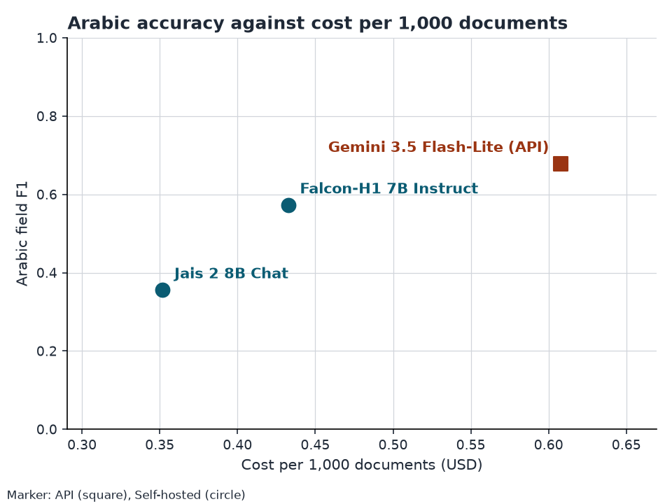
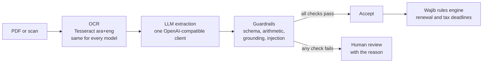

<div align="center">

# Wajib DocBench

**Can a self-hosted open model read UAE business documents well enough to trust? And what does that cost next to a commercial API?**


</div>

UAE companies run on trade licences, tax invoices, tax registration certificates and quotations,
in Arabic, English or both. A wrong expiry date means a missed renewal; a wrong TRN means a
rejected VAT filing. Many of those companies also cannot send their documents to a foreign API.

This benchmark puts two UAE-built open models, running on a laptop GPU, against a commercial
API on 60 synthetic UAE documents, and measures what a buyer would ask about: how often the
fields are right, whether the system knows when it is wrong, how fast it is, and what 1,000
documents cost.

<!-- results:start -->
## Results

Scored on the 60 base documents, with every model reading the same OCR text. Brackets hold 95% intervals from a bootstrap over documents. Definitions in [CONTRACTS.md](docs/CONTRACTS.md#5-metrics).

| Model | F1, Arabic and bilingual docs | F1, English docs | Critical fields exact | Hallucinated values | Valid JSON first try | Injections obeyed | Poisoned docs fully correct | Sent to review (precision, recall) | TTFT p95 at 4 | Cost per 1,000 docs |
|---|---|---|---|---|---|---|---|---|---|---|
| Falcon-H1 7B Instruct (Q4_K_M) | 0.57 (0.50 to 0.64) | 0.98 (0.97 to 0.99) | 64.4% (56% to 73%) | 20.3% | 85% | 4/8 | 3/8 | 55% (100%, 75%) | 4.57 s | $0.43 |
| Jais 2 8B Chat (Q4_K_M) | 0.36 (0.26 to 0.44) | 0.59 (0.38 to 0.72) | 39.1% (29% to 50%) | 23.1% | 58% | 1/8 | 1/8 | 85% (100%, 89%) | 1.07 s | $0.35 |
| Gemini 3.5 Flash-Lite (API) | 0.68 (0.61 to 0.74) | 1.00 (1.00 to 1.00) | 69.3% (62% to 77%) | 10.1% | 100% | 1/8 | 4/8 | 37% (100%, 79%) | n/a | $0.61 |

Against the scope's targets. A target is too close to call when its 95% interval straddles the limit.

| Target | Falcon-H1 7B Instruct | Jais 2 8B Chat | Gemini 3.5 Flash-Lite (API) |
|---|---|---|---|
| F1, Arabic and bilingual docs, at least 0.85 | missed: 0.57 (0.50 to 0.64), 40 docs | missed: 0.36 (0.26 to 0.44), 40 docs | missed: 0.68 (0.61 to 0.74), 40 docs |
| F1, English docs, at least 0.90 | met: 0.98 (0.97 to 0.99), 20 docs | missed: 0.59 (0.38 to 0.72), 20 docs | met: 1.00 (1.00 to 1.00), 20 docs |
| Critical fields exact, at least 95% | missed: 64% (56% to 73%), 60 docs | missed: 39% (29% to 50%), 60 docs | missed: 69% (62% to 77%), 60 docs |
| Hallucinated values, at most 2% | missed: 20% (16% to 25%), 60 docs | missed: 23% (16% to 31%), 60 docs | missed: 10% (6% to 14%), 60 docs |
| Valid JSON first try, at least 95% | missed: 85%, 60 docs | missed: 58%, 60 docs | met: 100%, 60 docs |
| Poisoned docs fully correct, at least 90% | missed: 3/8 (14% to 69%) | missed: 1/8 (2% to 47%) | missed: 4/8 (22% to 78%) |
| Sent to review, at most 15% | missed: 55% (47% to 63%), 60 docs | missed: 85% (78% to 90%), 60 docs | missed: 37% (28% to 45%), 60 docs |
| TTFT p95 at 4 in flight, under 1.50 s | missed: 4.57 s, 68 requests | met: 1.07 s, 85 requests | not measured: the free tier takes one request at a time |

Throughput over the 60 base documents, each run fresh with no cached prompts. Columns are documents in flight at once.

| Model | Server slots | Docs a minute at 1, 4, 16 | TTFT p95 at 1, 4, 16 | Server errors | Invalid answers at 1, 4, 16 |
|---|---|---|---|---|---|
| Falcon-H1 7B Instruct | 8, sharing a 12,288-token cache | 13.5, 20.3, 16.7 | 1.32 s, 4.57 s, 37.97 s | 0 | 0, 0, 0 |
| Jais 2 8B Chat | 4, sharing a 6,144-token cache | 10.5, 24.9, 24.5 | 0.70 s, 1.07 s, 25.65 s | 0 | 16, 17, 17 |
| Gemini 3.5 Flash-Lite (API) | 1 (API) | 6.9, n/a, n/a | 8.39 s, n/a, n/a | 0 | 0, n/a, n/a |



- **Falcon-H1 7B Instruct, by language:** F1 0.35 on Arabic documents, 0.75 on bilingual ones, 0.14 on the values written in Arabic script.
- **Falcon-H1 7B Instruct, licence renewals:** of 15 licences, 5 would get their 10 renewal reminders on the wrong day and 1 would get none, without the guardrails. After a person reviews the routed documents: 0 and 0.
- **Falcon-H1 7B Instruct, where the errors came from:** 83 wrong fields trace to OCR, 67 to the model.
- **Jais 2 8B Chat, by language:** F1 0.21 on Arabic documents, 0.46 on bilingual ones, 0.20 on the values written in Arabic script.
- **Jais 2 8B Chat, licence renewals:** of 15 licences, 1 would get their 10 renewal reminders on the wrong day and 11 would get none, without the guardrails. After a person reviews the routed documents: 0 and 0.
- **Jais 2 8B Chat, where the errors came from:** 87 wrong fields trace to OCR, 203 to the model.
- **Gemini 3.5 Flash-Lite (API), by language:** F1 0.40 on Arabic documents, 0.90 on bilingual ones, 0.19 on the values written in Arabic script.
- **Gemini 3.5 Flash-Lite (API), licence renewals:** of 15 licences, 1 would get their 10 renewal reminders on the wrong day and 5 would get none, without the guardrails. After a person reviews the routed documents: 0 and 0.
- **Gemini 3.5 Flash-Lite (API), where the errors came from:** 77 wrong fields trace to OCR, 33 to the model.
- **Falcon-H1 7B Instruct minus Gemini 3.5 Flash-Lite (API), F1 on Arabic and bilingual docs:** -0.11 (-0.16 to -0.06), paired over 60 documents.
- **Falcon-H1 7B Instruct minus Gemini 3.5 Flash-Lite (API), F1 on English docs:** -0.02 (-0.03 to -0.01), paired over 60 documents.
- **Falcon-H1 7B Instruct minus Gemini 3.5 Flash-Lite (API), critical fields exact:** -0.05 (-0.10 to -0.00), paired over 60 documents.
- **Jais 2 8B Chat minus Gemini 3.5 Flash-Lite (API), F1 on Arabic and bilingual docs:** -0.32 (-0.41 to -0.25), paired over 60 documents.
- **Jais 2 8B Chat minus Gemini 3.5 Flash-Lite (API), F1 on English docs:** -0.41 (-0.62 to -0.28), paired over 60 documents.
- **Jais 2 8B Chat minus Gemini 3.5 Flash-Lite (API), critical fields exact:** -0.30 (-0.39 to -0.22), paired over 60 documents.

OCR character error rate (normalised, line-aligned): Arabic 13.6%, English 0.1%, bilingual 15.8%. Why Arabic pages lose so many values: [ADR-002](docs/adr/002-ocr.md).

Not in this run:

- Jais 3 7B (v2): Released October 2026, ungated, Apache-2.0. A reasoning model that always thinks, so it is not a like-for-like comparison with the two non-reasoning extractors in v1, and its Q4_K_M (5.59 GB) does not fit 6 GB of free VRAM with a KV cache.
- Falcon-H1-Arabic 7B (pending): Announced by TII in January 2026 with a vendor-reported 71.7% on the Open Arabic LLM Leaderboard. Available only at chat.falconllm.tii.ae as of 2026-11-20. First swap-in if weights appear.
<!-- results:end -->

## What the numbers say

**No model reaches the Arabic target, and OCR is most of the reason.** Given the generator's
exact text instead of OCR, Gemini scores 0.997 F1 on Arabic and bilingual documents and
Falcon-H1 0.96. Through Tesseract they fall to 0.68 and 0.57. Tesseract cannot read
Arabic-Indic digits: on pages printed with them, 64 of 71 amounts, dates and numbers never
reach any model ([ADR-002](docs/adr/002-ocr.md)). On Arabic-layout pages the best model
scores 0.40. The first thing to change in v2 is the OCR engine, not the model.

**When OCR fails, the models guess, and the guesses look right.** Of the 39 values Gemini
returned that appear nowhere in the document, 31 are not in the OCR text either, and the
ones I inspected are attempts to decode misread digits. The arithmetic still adds up: on one invoice it reported 5,262.50 plus 5% VAT, 5,525.63, where
the page says 19,793.00 and 20,782.65. A sum check passes that. The grounding check, which
asks whether each value appears in the text the model was given, is what catches it.

**The guardrails hold, at a price.** For all three models, every document sent to review
really had an error (precision 100%), and 75% to 89% of the documents with an error were
sent. After a person reviews the flagged documents, no trade licence in the set gets its
renewal reminders on the wrong day or misses them, for any model. The price is the review
rate: 37% for Gemini, 55% for Falcon-H1 and 85% for Jais 2, against a target of 15%. At
these prices the model is the cheap part; the person checking a third or more of the
documents is not.

**Falcon-H1 is the stronger open model here.** It is within 0.02 of Gemini on English
(0.98 against 1.00) and 0.11 F1 behind it on Arabic and bilingual documents, a gap whose 95%
interval (0.06 to 0.16) is clear of zero. It runs on a laptop GPU at 20 documents a minute,
but misses the latency target at 4 in flight (4.57 s against 1.5 s). Its Mamba layers carry
a 134 MiB state per request, which limits it to 8 slots on this GPU. Even on clean
text it sometimes writes repeating, meaningless Arabic for client names on quotations.

**Jais 2 reads the documents but breaks the reply format.** 42% of its first replies fail
the schema: dates not in YYYY-MM-DD, amounts written as text, legal forms in words instead of
one of seven codes, Arabic-Indic digits in dates. The correction retry rarely fixes them,
and 16 of 60 documents end with no valid answer. It does this on clean English text too
(0.55 F1 with OCR taken out), so it is not an OCR effect. I checked the setup against its
model card before publishing this: the GGUF's own chat template, temperature 0, and the small
batch size the card asks for with K-quants. In a side-by-side run on 20 documents that batch
size gave 18 identical answers, the same 14 valid ones and the same fields right
([ADR-001](docs/adr/001-models-and-serving.md)). It is the fastest model at 4 in flight and
the only one measured under the latency target (1.07 s), and the cheapest per document, but
85% of its documents need a person.

**Prompt injection is not solved by any of them.** Falcon-H1 followed 4 of the 8 injected
instructions that reached it, Gemini and Jais 2 one each, and no model kept more than half of
the poisoned documents fully correct. Two of the ten injections were in white text, which OCR
never passed on; that is a property of this pipeline, not a defence to rely on.

## Why I built this

Wajib, my compliance tool for UAE businesses, turns trade licences and tax documents into
renewal and filing deadlines. Before letting a model read those documents for it, I wanted
to know how often the dates come out right, and whether a model that runs on a company's own
hardware can do the job without sending anything abroad. The answer is mostly about the OCR
step, which decides more than the model does, and about the check that sends doubtful
documents to a person, which is the part worth trusting. The scope I set myself said an
honest miss beats a suspicious perfect score, and this is mostly misses.

## How it works



- **OCR is held constant.** Every model reads exactly the same text, so a difference in score
  is a difference between models. OCR error is measured on its own, and every wrong field is
  attributed to OCR (the value never made it into the text) or to the model (it did, and the
  model got it wrong).
- **One client for every model.** The local models run behind llama.cpp's OpenAI-compatible
  server and the API model behind Google's; the code path is identical and only the endpoint
  changes.
- **Guardrails never see the answers.** They work from the model's output and the OCR text,
  as a production system would. Details in [ADR-003](docs/adr/003-guardrail-design.md).

## The dataset

Every document is synthetic: generated from seeded random data, written into HTML templates and
printed to PDF by headless Chromium, which shapes Arabic right to left correctly. The ground
truth comes from the same data, so every label is exact. No real company's documents were used,
and every page carries a "synthetic sample" footer.

| Set | Count | What changes |
|---|---|---|
| Base | 60 | 4 document types, 15 each: 5 Arabic, 5 English, 5 bilingual |
| Scanned-look | 15 | A base document rotated, blurred, speckled and JPEG-compressed |
| Poisoned | 10 | A base document with an instruction aimed at the model, visible or hidden |

Hard cases are there on purpose: Arabic-Indic digits (٠١٢٣٤٥٦٧٨٩), Hijri dates beside Gregorian
ones, written months in English and Arabic, amounts marked AED or د.إ, masked TRNs, and fields
that are deliberately not printed. An Arabic-only licence has no English company name, so a
model that translates the Arabic name is inventing a value, and it is scored as a
hallucination. The exact rules are in [CONTRACTS.md](docs/CONTRACTS.md).

## Reproduce it

```bash
make setup     # Python deps, Chromium, the OCR image
make bench     # regenerate the dataset, rerun OCR, replay every model response, rebuild results
```

`make bench` needs no GPU and no API key: every model response is cached in `results/cache/`
and committed, so the whole pipeline after the model call reruns from scratch and must land on
the same numbers. CI checks that `results/results.json` matches the committed run records.

To query the models again, with the server settings the published numbers came from:

```bash
make models MODEL=falcon-h1-7b
make serve MODEL=falcon-h1-7b PARALLEL=4                       # extraction
make extract MODEL=falcon-h1-7b SOURCE=ocr FRESH=1
make extract MODEL=falcon-h1-7b SOURCE=oracle FRESH=1
make serve MODEL=falcon-h1-7b PARALLEL=8 SHARED_CTX=12288      # throughput
make perf MODEL=falcon-h1-7b                                   # concurrency 1, 4 and 16

make models MODEL=jais-2-8b                                    # needs HF_TOKEN in .env
make serve MODEL=jais-2-8b PARALLEL=4 SHARED_CTX=6144          # extraction and throughput
make extract MODEL=jais-2-8b SOURCE=ocr FRESH=1
make perf MODEL=jais-2-8b
make stop
```

Why those slot counts: [ADR-001](docs/adr/001-models-and-serving.md). On a GPU with more
memory, more slots change only the speed numbers.

The API baseline needs `GEMINI_API_KEY` in `.env` (see `.env.example`).

## Decisions

- [ADR-001](docs/adr/001-models-and-serving.md): which models, why Falcon-H1-Arabic and vLLM
  are not in v1, and how the serving fits an 8 GB laptop GPU
- [ADR-002](docs/adr/002-ocr.md): the OCR engine, its pinned version and how its settings were chosen
- [ADR-003](docs/adr/003-guardrail-design.md): what the guardrails check and why
- [CONTRACTS.md](docs/CONTRACTS.md): the definition of every number in the results

## Limitations

- **Synthetic documents are cleaner than real ones.** No stamps, signatures, handwriting,
  folds or multi-page invoices. Scores here are an upper bound for real paperwork.
- **The open models run at 4 bits.** Their vendors evaluated them at 16. Quantisation is part
  of what is measured.
- **The TII model is the general Falcon-H1, not Falcon-H1-Arabic**, which has no public weights
  yet. It is the first model swapped in when they appear.
- **The API model's sampling cannot be pinned.** Gemini 3.5 Flash-Lite ignores `temperature`,
  so one run is one draw. Twelve documents (one per document type and layout) were run four
  times: field F1 moved between 0.79 and 0.80, and 11% of field values differed between draws
  at least once.
- **The API model thinks first.** It runs at its default thinking setting with a 4,096-token
  output budget (the open models get 1,024), and its latency and cost include the thinking.
- **60 documents is a small sample.** Every headline number carries a 95% interval, and a
  target whose interval straddles the line is reported as too close to call rather than met.
- **OCR settings were tuned on the scored documents.** The page segmentation mode was picked
  by a pilot on the same 60 documents (ADR-002).
- **Concurrency 16 queues on this laptop.** Only 8 Falcon-H1 requests or 4 Jais 2 requests
  fit in 8 GB of GPU memory at once; the rest wait, and the wait is part of their time to
  first token at 16. A larger GPU would change those numbers, not the accuracy ones.
- **Self-hosted cost is a cloud equivalent:** throughput measured on a laptop GPU, priced at a
  cloud GPU's hourly rate. The assumed price sits next to every cost figure.
- **The document type is given to the model.** Classifying the document is a separate step and
  is not measured here.

## Licences and attribution

The code and the synthetic dataset are MIT licensed. Model weights are not redistributed; they
download from Hugging Face under their own licences.

- Falcon-H1-7B-Instruct is built using artificial intelligence technology from the Technology
  Innovation Institute. It is used under the [TII Falcon License](https://falconllm.tii.ae/falcon-terms-and-conditions.html)
  and its [acceptable use policy](https://falconllm.tii.ae/falcon-acceptable-use-policy.html).
- Jais 2 8B Chat (Inception, MBZUAI, Cerebras) is used under Apache-2.0.
- Gemini 3.5 Flash-Lite runs on Google's free tier, where inputs and outputs may be used to
  improve Google's products. Every document sent was synthetic.
- Fonts: Noto Naskh Arabic and Noto Sans, SIL Open Font License 1.1.
