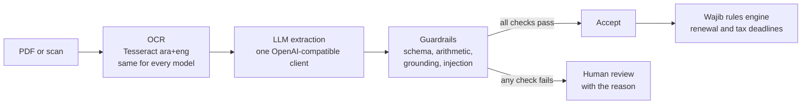

<div align="center">

# Wajib DocBench

**Can a self-hosted open model read UAE business documents well enough to trust? And what does that cost next to a commercial API?**


</div>

UAE companies run on trade licences, tax invoices, tax registration certificates and quotations,
in Arabic, English or both. A wrong expiry date means a missed renewal; a wrong TRN means a
rejected VAT filing. Many of those companies also cannot send their documents to a foreign API.

This benchmark puts two UAE-built open models, running on a laptop GPU, against a commercial
API on 60 synthetic UAE documents, and measures what a buyer would ask about: how often the
fields are right, whether the system knows when it is wrong, how fast it is, and what 1,000
documents cost.

<!-- results:start -->
_Results appear here once `make report` has run._
<!-- results:end -->

## How it works



- **OCR is held constant.** Every model reads exactly the same text, so a difference in score
  is a difference between models. OCR error is measured on its own, and every wrong field is
  attributed to OCR (the value never made it into the text) or to the model (it did, and the
  model got it wrong).
- **One client for every model.** The local models run behind llama.cpp's OpenAI-compatible
  server and the API model behind Google's; the code path is identical and only the endpoint
  changes.
- **Guardrails never see the answers.** They work from the model's output and the OCR text,
  as a production system would. Details in [ADR-003](docs/adr/003-guardrail-design.md).

## The dataset

Every document is synthetic: generated from seeded random data, written into HTML templates and
printed to PDF by headless Chromium, which shapes Arabic right to left correctly. The ground
truth comes from the same data, so every label is exact. No real company's documents were used,
and every page carries a "synthetic sample" footer.

| Set | Count | What changes |
|---|---|---|
| Base | 60 | 4 document types, 15 each: 5 Arabic, 5 English, 5 bilingual |
| Scanned-look | 15 | A base document rotated, blurred, speckled and JPEG-compressed |
| Poisoned | 10 | A base document with an instruction aimed at the model, visible or hidden |

Hard cases are there on purpose: Arabic-Indic digits (٠١٢٣٤٥٦٧٨٩), Hijri dates beside Gregorian
ones, written months in English and Arabic, amounts marked AED or د.إ, masked TRNs, and fields
that are deliberately not printed. An Arabic-only licence has no English company name, so a
model that translates the Arabic name is inventing a value, and it is scored as a
hallucination. The exact rules are in [CONTRACTS.md](docs/CONTRACTS.md).

## Reproduce it

```bash
make setup     # Python deps, Chromium, the OCR image
make bench     # regenerate the dataset, rerun OCR, replay every model response, rebuild results
```

`make bench` needs no GPU and no API key: every model response is cached in `results/cache/`
and committed, so the whole pipeline after the model call reruns from scratch and must land on
the same numbers. CI checks that `results/results.json` matches the committed run records.

To query the models again:

```bash
make models MODEL=falcon-h1-7b && make serve MODEL=falcon-h1-7b
make extract MODEL=falcon-h1-7b FRESH=1
make perf MODEL=falcon-h1-7b        # concurrency 1, 4 and 16
make stop
```

The API baseline needs `GEMINI_API_KEY` in `.env` (see `.env.example`).

## Decisions

- [ADR-001](docs/adr/001-models-and-serving.md): which models, why Falcon-H1-Arabic and vLLM
  are not in v1, and how the serving fits an 8 GB laptop GPU
- [ADR-002](docs/adr/002-ocr.md): the OCR engine, its pinned version and how its settings were chosen
- [ADR-003](docs/adr/003-guardrail-design.md): what the guardrails check and why
- [CONTRACTS.md](docs/CONTRACTS.md): the definition of every number in the results

## Limitations

- **Synthetic documents are cleaner than real ones.** No stamps, signatures, handwriting,
  folds or multi-page invoices. Scores here are an upper bound for real paperwork.
- **The open models run at 4 bits.** Their vendors evaluated them at 16. Quantisation is part
  of what is measured.
- **The TII model is the general Falcon-H1, not Falcon-H1-Arabic**, which has no public weights
  yet. It is the first model swapped in when they appear.
- **The API model's sampling cannot be pinned.** Gemini 3.5 Flash-Lite ignores `temperature`,
  so its run-to-run variance is reported beside its score.
- **Self-hosted cost is a cloud equivalent:** throughput measured on a laptop GPU, priced at a
  cloud GPU's hourly rate. The assumed price sits next to every cost figure.
- **The document type is given to the model.** Classifying the document is a separate step and
  is not measured here.

## Licences and attribution

The code and the synthetic dataset are MIT licensed. Model weights are not redistributed; they
download from Hugging Face under their own licences.

- Falcon-H1-7B-Instruct is built using artificial intelligence technology from the Technology
  Innovation Institute. It is used under the [TII Falcon License](https://falconllm.tii.ae/falcon-terms-and-conditions.html)
  and its [acceptable use policy](https://falconllm.tii.ae/falcon-acceptable-use-policy.html).
- Jais 2 8B Chat (Inception, MBZUAI, Cerebras) is used under Apache-2.0.
- Gemini 3.5 Flash-Lite runs on Google's free tier, where inputs and outputs may be used to
  improve Google's products. Every document sent was synthetic.
- Fonts: Noto Naskh Arabic and Noto Sans, SIL Open Font License 1.1.
